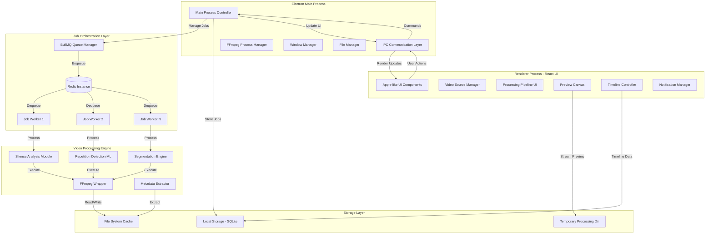
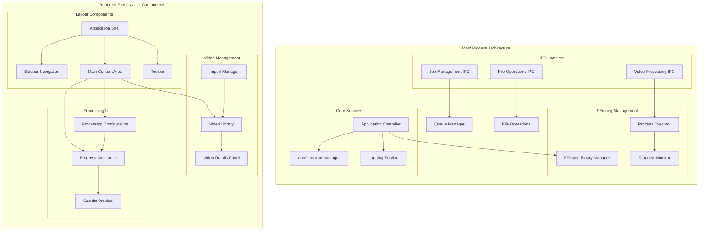
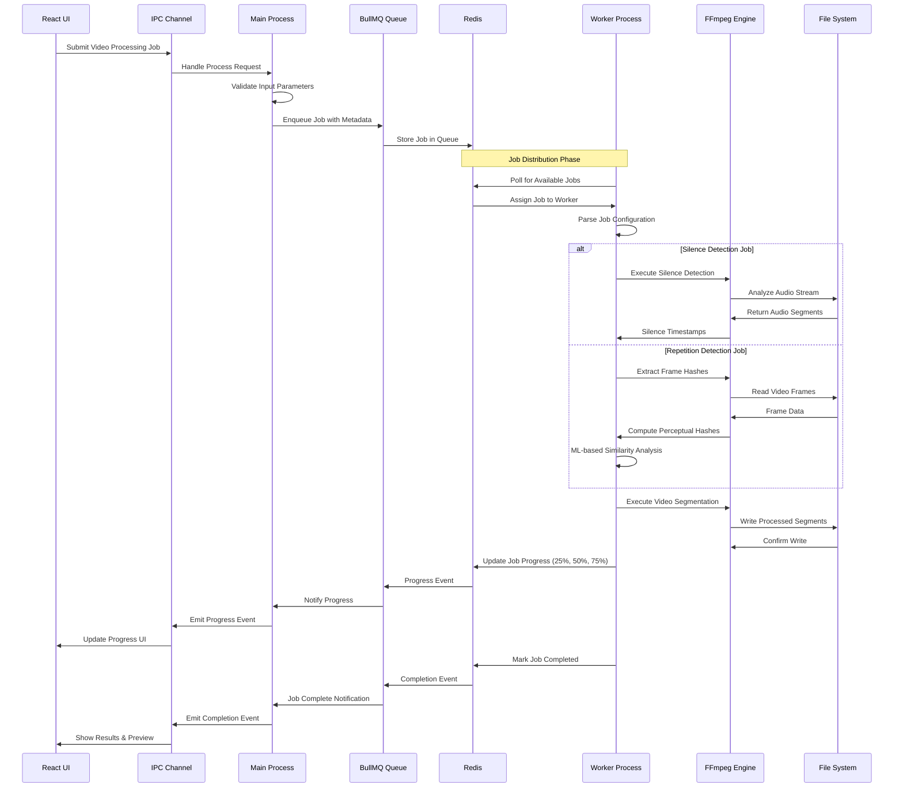
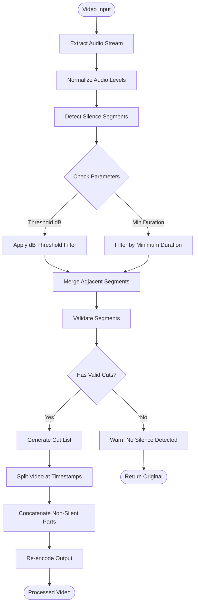
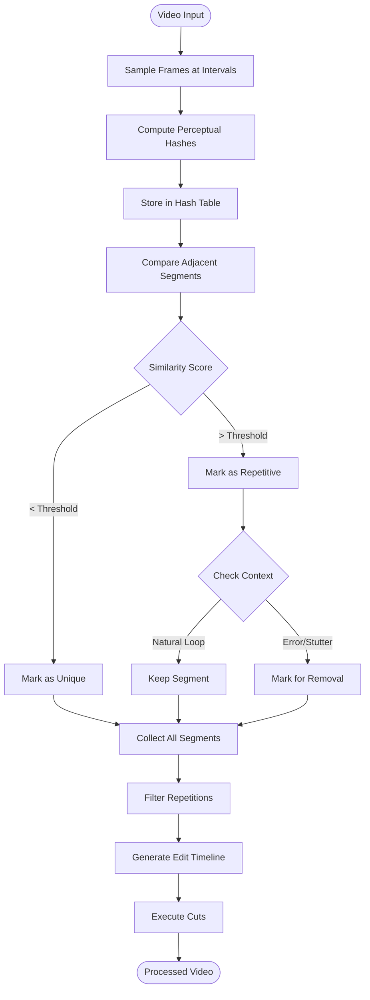
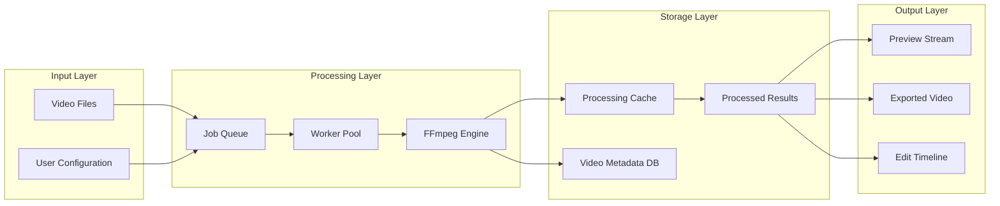
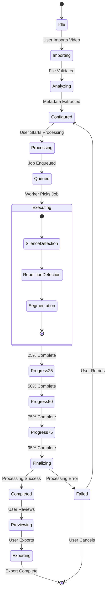
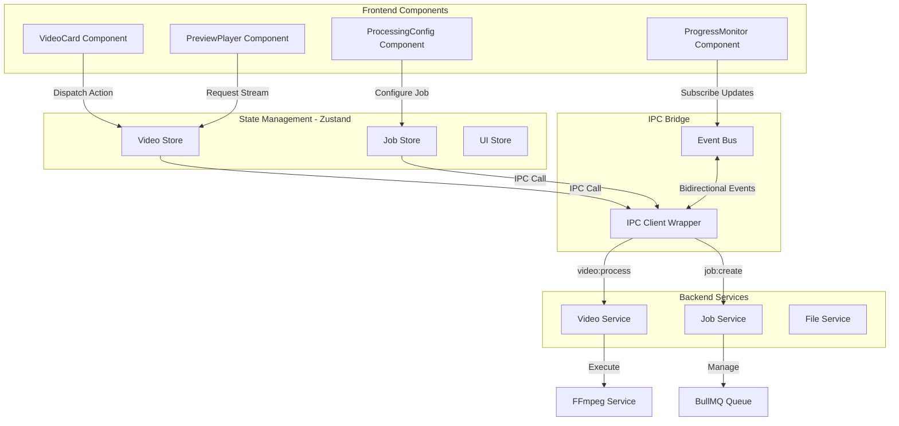
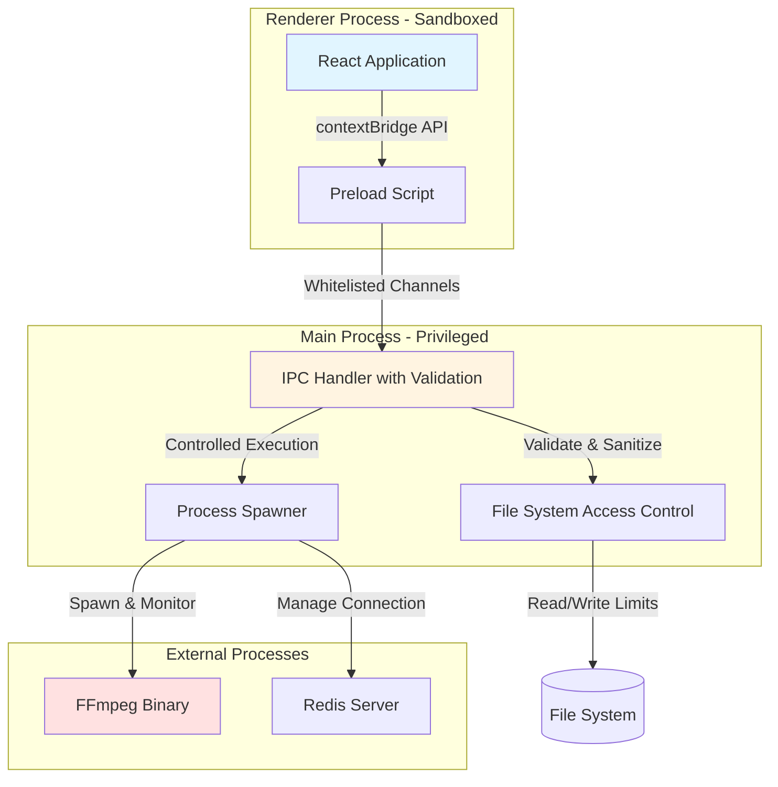

# Video Editing Assistant - System Architecture

## High-Level System Architecture

## Detailed Component Architecture

## Job Processing Pipeline

## Silence Detection Algorithm Flow

## Repetition Detection Algorithm Flow

## Data Flow Architecture

## State Management Architecture

## Component Interaction Model

## Security & Sandboxing Architecture

